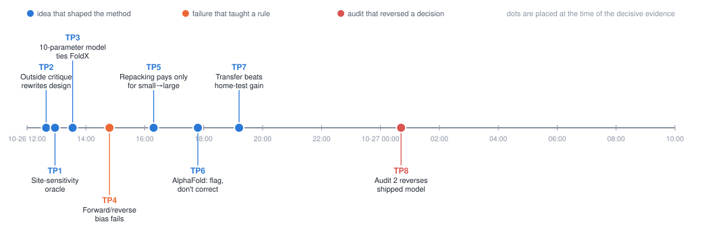

# How we got here: the research journey

**Main point.** The final method looks the way it does because of eight decisions, most of them forced by evidence
that contradicted an early assumption. Seven of them took place within about seven hours on 26 October 2026 (12:40–19:12 UTC); the eighth
(the audit that reversed the shipped model) came the following night. The project was run by a "PI" agent that
delegated to 29 subagents; the human gave the brief and a few logistical instructions, and did not steer the science.

Times are UTC from the transcripts (git shows local time, one hour later). Decision IDs (D1–D23) are those in
`RESEARCH_TREE.md`. Sources: the PI transcript, 29 subagent logs, `RESEARCH_TREE.md`, `notes/*.md`, `git log`.

---

## TP1. Where does the accuracy live? (12:57, literature agent)

**Situation.** Before any engine existed, the question was what a physics model should be good at.
**Options.** (a) Refit FoldX's own 22 terms to Megascale; (b) build a new energy engine and hope; (c) find out first
where the signal in the data is.
**Evidence.** The literature agent computed two things. A leave-one-out *site-mean oracle* (predict each mutation by
the average ΔΔG of the other mutations at the same site) reaches pooled ρ = 0.757 on Megascale-test, and 0.80 when
the amino-acid identity is added. And refitting FoldX's 22 terms under protein-grouped cross-validation scored 0.541,
*worse* than stock FoldX (0.569).
**Outcome.** The PI asked every later agent to report site-level and within-site ranking separately. The ladder then
showed that even the simplest model has site-level ρ 0.68 against within-site 0.44. FoldX re-weighting was never
attempted. **Shaped:** the structure statistics and burial terms (Method [step 1](METHOD.md#step-1-read-the-structure-and-describe-every-position)
and [step 4](METHOD.md#step-4-add-what-known-structures-say-about-this-kind-of-position)).
*Where:* `LITERATURE.md` §2, `scripts/lit_site_vs_substitution.py`, tree 1.1a/1.1b, commit `a0003cd`.

## TP2. An outside critique rewrites the design before anything is fitted (12:40)

**Situation.** The PI had written `DESIGN.md` v0: ~13 energy terms, minimum-energy repacking, a soft-clipped link and
20 reference energies. A fresh subagent was asked to critique it only from the document; it returned in nine minutes.
**Options.** Accept or reject each of ~10 proposals. The PI accepted nearly all and rejected one sequencing proposal
(build the neighbour-repacking stage only after the first gates pass), because it was needed for the AlphaFold mode
and shares machinery with ensemble averaging.
**Evidence in the critique.** (1) The largest omission is an environment-dependent statistical potential. (2)
Reference energies are confounded with Megascale's own unfolded-state model, so they must be shrunk and
assay-specific parts dropped at inference. (3) Censoring happens in ΔG space and cannot be handled by one soft clip.
(4) Using the experimental "current" rotamer silently breaks wild-type/mutant symmetry. (5) A separate entropy term is
redundant with Boltzmann averaging.
**Outcome.** Decisions D4–D10 and seven pre-registered gates (G1–G7), written before any benchmark number existed.
**Shaped:** [step 2](METHOD.md#step-2-build-every-candidate-side-chain-at-the-site-for-the-wild-type-and-all-19-mutants-alike)
(symmetric rebuilding), [step 3](METHOD.md#step-3-score-the-shapes-with-physics-and-average-them) (Boltzmann average),
[step 4](METHOD.md#step-4-add-what-known-structures-say-about-this-kind-of-position) (environment potential),
[step 5](METHOD.md#step-5-combine-everything-with-a-small-fitted-linear-model) (censoring, shrunk reference energies).
*Where:* `notes/critique_design_v0.md`, `DESIGN.md` (v1 revisions), commit `caa78ca`.

## TP3. A 10-parameter model with no side chains matches FoldX (13:33)

**Situation.** The fitting agent built a ladder of simple baselines before the physics engine was ready: residue-pair
lookup, burial only, burial + environment statistics, and so on.
**Evidence.** "B3+" (environment potential, burial, Ramachandran, Pro/Gly indicators, plus the 20 reference
energies; 10 weights) scored 0.648 per-protein ρ on Megascale-test against FoldX 0.629 and 0.43 against 0.41 on
FireProt. The original gate (engine ≥ 2-weight model B3 + 0.03) was far too easy.
**Options.** Keep the old gate, or re-base it on the strongest simple model.
**Outcome.** D16: the engine had to beat B3+ by 0.03 *and* FoldX with a confidence interval excluding zero. In the
end the engine passed against B3+ (+0.044, CI [0.018, 0.071]) but, on crystal benchmarks, never clearly did (a limit
stated in the report). The ladder also showed that Domainome behaves differently from Megascale at the surface
(core transfer ρ 0.84, surface −0.09). **Shaped:** the honest framing of the method and the structure-statistics
block of [step 4](METHOD.md#step-4-add-what-known-structures-say-about-this-kind-of-position); the transfer check
(G6) that removed two terms (cis-Pro, overpacking) and the sign-checked weights in [step 5](METHOD.md#step-5-combine-everything-with-a-small-fitted-linear-model).
*Where:* `notes/baseline_ladder.md`, D15/D16, commits `2a6b530`, `d428000`.

## TP4. The native-adaptation problem: forward and reverse mutations disagree (14:48–17:34)

**Situation.** Unfitted energies scored a mutation A→B on structure 1 and B→A on structure 2 very differently: the two
predictions correlated at r = 0.04–0.13 with a bias of +6 to +8 kcal/mol. Each structure is adapted to the residue it
contains, so any change looks destabilising.
**Options tried (four).** (a) D15: build every term as a difference of one state function and allow no burial-only terms;
(b) site-dependent repulsion caps (cap A/B/C, hard/soft); (c) score the reverse mutation in the modelled mutant
environment and symmetrise; (d) drop wild-type-only main effects.
**Evidence.** Fitting cut the bias from 8.0 to 1.4 kcal/mol. Caps reduced the repulsion bias (+7.5 → +4.2, or +3.2
with soft repulsion) but changed validation ρ by only 0.010. Symmetrising on one structure left r = 0.15. Dropping
wild-type-only terms reached r = 0.59 at a cost of 0.044 ρ.
**Outcome.** Accepted as a permanent weakness (forward/reverse r ≈ 0.24 against 0.88 for KORPM): "antisymmetry cannot
be obtained from one structure with a fixed-backbone model". What survived is the design rule that the wild type is
rebuilt like the mutant ([step 2](METHOD.md#step-2-build-every-candidate-side-chain-at-the-site-for-the-wild-type-and-all-19-mutants-alike)),
which removes the bias at the source, plus a unit test that WT→WT is exactly 0. A dead end that taught a rule.
*Where:* `notes/engine_mutate.md` ("v2 additions"), `results/ladder_physics/antisymmetry*.csv`, commits `054516a`, `18dffdd`, `794bb2c`.

## TP5. Is neighbour repacking worth its cost? (16:20–17:43)

**Situation.** Stage 2 (neighbouring side chains also adapt) is the most expensive component and the critic expected
little gain.
**Evidence.** The first fit gave B4 (stage 1) 0.677 and B5 (stage 2) 0.687. The pre-registered gate G2 (+0.02 overall)
failed (+0.010), but on buried small→large substitutions, the class stage 2 was designed for, stage 2 gained
+0.048 (then +0.058 out-of-fold on held-out data, 5 of 5 folds). A backbone ensemble tried afterwards (nine times the
cost) gave no gain at all.
**Outcome.** Both stages ship: stage 1 as the fast default for large scans, stage 2 for accuracy and for AlphaFold
models (it also cost only ~2.3× more). The backbone ensemble was dropped. **Shaped:** the two-stage structure of
[step 3](METHOD.md#step-3-score-the-shapes-with-physics-and-average-them).
*Where:* `notes/ladder_physics.md` (gate table), `notes/engine_mutate.md`, commits `5942d30`, `fb91835`.

## TP6. For AlphaFold models, flag the bad regions instead of correcting them (14:39–17:47)

**Situation.** The brief asked for an AlphaFold-specific mode. The obvious design: shrink predictions where pLDDT is low.
**Evidence.** (1) On 3,858 paired variants the AlphaFold model was never worse than the crystal and was better where
they differ (local RMSD 0.6–1 Å: ρ 0.46 vs 0.17 for unfitted energies). (2) Re-packing all side chains made
crystal/AlphaFold agreement worse (0.950 → 0.940). (3) pLDDT shrinkage gained +0.022 on Domainome, but a
*burial-matched* control with the same two parameters gained +0.073: the "AlphaFold correction" was a burial
calibration. (4) Withholding the 14% of variants that are low-pLDDT, terminal, in exposed hydrophobic patches or at
metal sites gained +0.038, more than all treatments together.
**Outcome.** D18: trim, crop to the assayed domain, keep AlphaFold side chains outside a 6 Å shell, and flag
(`withheld`). A pLDDT attenuation was later added for AlphaFold inputs only, but its weight's confidence interval
includes zero and the gain is +0.006 to +0.018, so it is not a headline claim. **Shaped:** the AlphaFold branch of
[step 1](METHOD.md#step-1-read-the-structure-and-describe-every-position) and all of
[step 6](METHOD.md#step-6-report-and-say-when-not-to-trust-the-number).
*Where:* `notes/af_mode.md`, D18, commits `6b87e15`, `50a67ee`.

## TP7. Residual analysis adds two terms, and "must transfer" removes the biggest one (17:23–19:12)

**Situation.** The engine had plateaued. A residual analysis asked which structural features explain what is left.
**Evidence.** Of 51 candidate terms only `site_scsc` (side-chain contacts at the site) passed a strict rule; a
pre-fixed relaxed rule added N-cap preference, helix dipole, buried side-chain H-bond partners and pLDDT attenuation
(validation 0.733 → 0.749). The analyst flagged that the helix and N-cap scales in the code were "typed from memory";
the N-cap table contradicted its source (Gln), so it was replaced by a potential derived from 58,800 PDB N-caps. The
new model passed the FoldX gate on rank (+0.072, CI [0.015, 0.133]) but `site_scsc` hurt FireProt (−0.026 Pearson) and
the strict S669/S461 sets, and sat at the edge of the transfer check.
**Options.** Ship the best Megascale model or the most transferable one. The PI cited the brief ("the physics must
transfer") and shipped the model without `site_scsc` and without the buried-H-bond term (D19).
**Outcome.** The shipped model is deliberately worse on its home test than it could be, and statistically
indistinguishable from the previous rung (+0.005, CI [−0.004, +0.019]). **Shaped:** the N-cap and helix-dipole terms in
[step 4](METHOD.md#step-4-add-what-known-structures-say-about-this-kind-of-position).
*Where:* `notes/residual_analysis.md`, D19, commits `9d5d501`, `fecda54`, `7e8989e`.

## TP8. A second audit reverses the shipped model (00:07–09:36 the next day)

**Situation.** After a critique, the PI shipped a joint Megascale + FireProt model (D22), which seemed to improve
FireProt (0.482) and Domainome at no cost.
**Evidence (audit 2, 35 minutes).** (1) The FireProt column covered 338 of 347 rows because one comparison method
failed on exactly two rows (disulfide-bonded enzymes), the rows that discriminated the models; on all 347 the joint
model's Pearson was 0.388, below the simpler models, and the whole joint advantage came from one weight fitted on ~8
rows. (2) At least 12 evaluations had touched test data, at least 5 of which changed what ships. (3) Several shipped
files were hand-made aliases and stale.
**Options.** Defend the joint model, patch the numbers, or re-decide from scratch using only validation and
cross-validation. The PI chose the last and said so: "I'm correcting them rather than working around them."
**Outcome.** The 8-row term was dropped; the family was re-decided on validation (0.741 vs 0.730) and cross-validation
(0.681 vs 0.665) alone, so the Megascale-only family ships and the joint fits become an optional "multi-assay"
variant. All claims were rewritten (D23), and "physics generalises across assays" was withdrawn. **Shaped:**
the fitting rules in [step 5](METHOD.md#step-5-combine-everything-with-a-small-fitted-linear-model) and every claim in
Results and Limitations.
*Where:* `notes/audit_2.md`, D23, commits `f707673`, `d684399`, `47a1b89`.

---

## Appendix: dead ends and what each taught

| attempt | result | lesson |
|---|---|---|
| Refit FoldX's 22 terms | 0.541 < stock 0.569 | re-weighting an existing term set is not where gains are (TP1) |
| GPU Rosetta (tmol) as the engine | raw 0.49; refit 0.60; 3.1 min per scan | clashes plus speed ruled it out; kept as baseline |
| Backbone ensemble | no gain, 9× cost | local side-chain flexibility is enough at this accuracy (TP5) |
| Elastic-network "dynamics" | correlates −0.85…−0.91 with contact number | in small domains it is burial in disguise |
| End-to-end fit of 32 physical constants | no ranking gain; all within ×/÷1.6 of literature; two assays agree (r = 0.80) | literature force-field values are near a local optimum |
| Megascale double mutants for coupling terms | no distance trend once the assay floor is removed | little pairwise signal to capture |
| Floor-aware (Tobit) loss refinement | CV 0.681 → 0.672 | fit was not floor-biased |
| Evolution profile (one weight) | +0.04 Megascale, +0.07 Domainome, but vanishes on 14 strict proteins | a different information source; kept out of the headline and never wired into the predictor |
| Joint Megascale+FireProt as default | retracted by audit 2 (TP8) | a gain carried by 8 rows is not a gain |

---

## The research process itself

**What the main agent did.** The PI agent wrote `PROMPT.md`, the first design, the gates and every decision (D1–D23);
it made the calls that mattered most: accepting the outside critique (TP2), moving the bar to B3+ (TP3), choosing
transfer over home-test gain (TP7) and retracting the joint model (TP8). It also made errors it later had to correct:
it first declared a gate passed (G1) that audit 1 showed failing, and it twice shipped a term built on test rows or on
8 rows.

**What subagents did.** 29 subagent logs: 20 spawned by the PI, 3 by the literature agent, 6 by those. Four roles
produced the method: the *engine* agent (geometry, rotamers, mutation scan, predictor), the *energy* agent (force-field
terms, parameter verification), the *fitting* agent (every fitted model, nine separate assignments over two days), and
the *AlphaFold* agent. Three roles produced the *evidence discipline*: the design critic (TP2), and two auditors
(audit 1, which produced the reporting protocol D17, and audit 2 in TP8). Others curated data, ran competitors, or wrote the manuscript and release.

**Where exploration was productive.** Early, cheap, independent checks (the site-oracle, the baseline ladder, the
outside critique, the AlphaFold control experiment) each changed the design. The auditors, given only code and
results, found problems the builders could not.

**Where it went in circles.** The shipped model family flipped from the Megascale-only set to the joint set and back
(two rewirings of the predictor defaults, README and examples regenerated each time); the main ladder script was
re-run end to end at least ten times; repulsion-cap variants cost many hours and landed within noise; a speed
regression and its repair cost ~half an hour. A safety-classifier stop interrupted 16 of the 29 subagent logs (9 times in the fitting agent alone); work resumed each time and no result changed.

**Where humans changed direction.** Rarely. The brief fixed the goals ("generalise across assays" is the sentence the PI
cites when dropping the best-scoring term in TP7). Later messages were logistical: "keep going", "try again" after a
usage limit, "are you done?", and release instructions (keep the full git history; remove personal identifiers).
