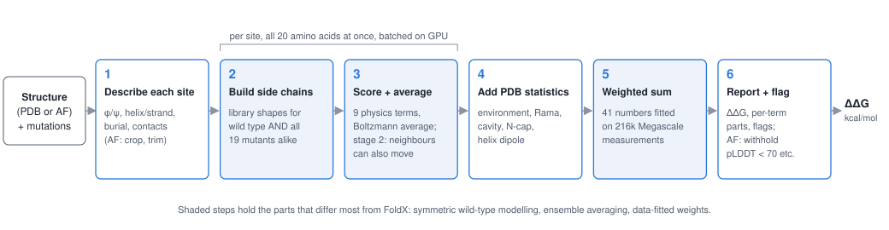
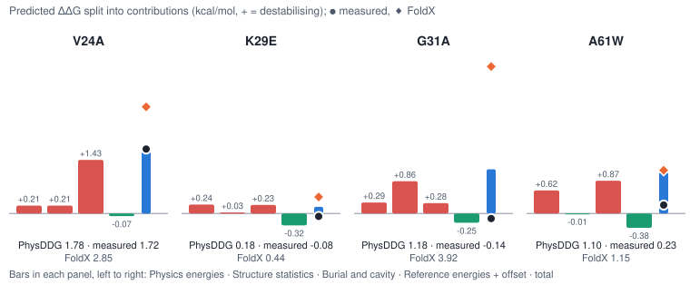
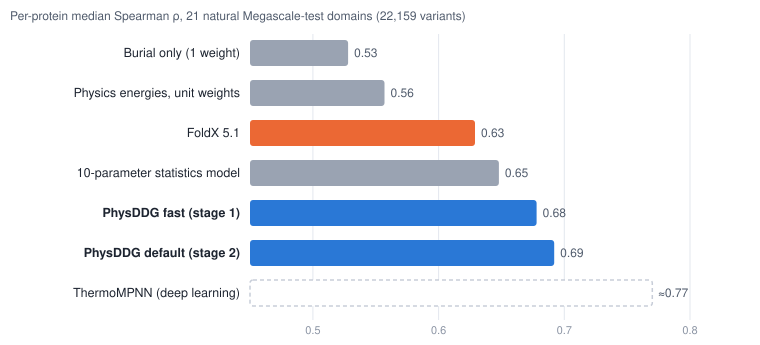
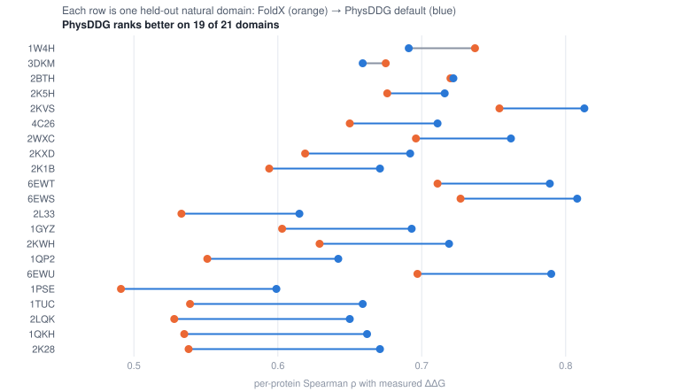

# PhysDDG: the method

**In one sentence.** PhysDDG takes a protein's 3D structure (an X-ray model or an AlphaFold model) and a list of single
amino-acid substitutions, and returns for each one the predicted change in folding stability, ΔΔG in kcal/mol,
split into named physical contributions, at roughly 1 ms per mutation on one GPU.

**In three sentences.** For every mutated position it builds the original and the new side chain in the same way, in
many possible shapes, and scores each shape with a classical physics energy (atoms touching, atoms clashing,
contact with water, hydrogen bonds, charges). It adds a few statistics learned from thousands of known protein
structures (how buried the position is, which amino acids normally sit in such places, which backbone angles each
amino acid tolerates). A weighted sum with 41 numbers fitted to 216,000 measured stability changes turns all of this
into one ΔΔG, and on held-out proteins it ranks mutations better than FoldX, the standard physics-based tool.

Terms used throughout:

| term | meaning |
|---|---|
| ΔΔG | change in folding free energy caused by a mutation, in kcal/mol. Here **positive = destabilising** (the mutant unfolds more easily). 1 kcal/mol is roughly the effect of losing one good hydrogen bond. |
| side chain, rotamer | the part of an amino acid that differs between the 20 types; a *rotamer* is one of its typical shapes (a few to ~30 per amino acid). |
| backbone | the chain of atoms shared by all amino acids. PhysDDG keeps it fixed. |
| burial, RSA | how much of a residue is hidden from water. RSA (relative solvent accessibility) is 0 for fully buried, 1 for fully exposed. |
| pLDDT | AlphaFold's per-residue confidence, 0–100. Below 70 the local structure is often unreliable. |
| Megascale | Tsuboyama et al. 2023: ~776,000 stability measurements on small domains (40–72 residues) from a protease-based assay. Its training split (215,731 single mutants, 239 domains) is what PhysDDG is fitted on. |
| per-protein Spearman ρ | rank correlation between predicted and measured ΔΔG within one protein, then the median over proteins. It asks "does the method order the mutations of a protein correctly?" and is the main metric here. |
| FoldX | the most widely used physics-based ΔΔG tool (Guerois et al. 2002; Schymkowitz et al. 2005). |

## How it differs from the standard approaches

There are three families of ΔΔG predictors. PhysDDG sits between the first two and deliberately avoids the third.

| | classical force-field tools (FoldX, Rosetta) | statistical / descriptor models (PoPMuSiC, KORPM, DDGun) | deep learning (ThermoMPNN, SPURS) | **PhysDDG** |
|---|---|---|---|---|
| what is computed | one best mutant model, energy difference | lookup tables over structural environments | learned representation of structure/sequence | physics energies averaged over many side-chain shapes, **plus** structural statistics |
| what is fitted, on what | ~10–20 weights, ~1,000 classic measurements (FoldX, 2002) | ~10–20 weights on curated literature sets | millions of parameters on Megascale | **41 weights** on 216k Megascale measurements, with held-out proteins for every choice |
| speed for a full scan of a 269-residue protein | 7–14 CPU-hours (FoldX) | seconds | seconds (GPU) | **3.6 s (fast mode) / 8 s (default) on one GPU** |
| interpretable per mutation | yes | partly | no | **yes, every term is reported** |
| Megascale-test per-protein ρ (21 natural domains) | 0.63 (FoldX) | 0.50–0.52 (KORPM, DDGun3D) | ≈0.77 (ThermoMPNN, published) | **0.69** |

Four design choices make the difference, and each is explained in the steps below:
1. **The wild type is modelled exactly like the mutant.** FoldX and Rosetta start from the experimental wild-type side
   chain and build only the mutant. Any modelling error then lands entirely on the mutant side and looks like
   destabilisation. PhysDDG throws away the input side chain at the mutated site and rebuilds both from the same
   library, so modelling errors cancel in the difference.
2. **It averages over side-chain shapes instead of picking one.** A single best model is fragile: one slightly wrong
   rotamer can produce a huge clash. A Boltzmann average (each shape weighted by exp(−energy/kT)) is smooth and
   gives side-chain entropy for free.
3. **It mixes physics with statistics and lets data decide the mix.** A weighted sum of statistical terms alone
   already ties FoldX. Physics adds about +0.04 per-protein ρ on top of that.
4. **Everything is batched on the GPU.** All 20 amino acids at all positions are evaluated as one tensor computation,
   so a saturation scan costs seconds, not CPU-hours.

## Overview



## The method in six steps

### Step 1. Read the structure and describe every position
**What.** Load the structure (heavy atoms, fixed backbone) and compute, for every residue: backbone angles φ/ψ,
secondary structure (helix, strand, loop), burial (RSA and the number of nearby Cβ atoms), and the position within a
helix (N-cap, ends). With `--mode af` and an AlphaFold model, also crop to the assayed domain, trim long
low-confidence segments, and mark positions that should not be trusted (step 6).
**Why.** Almost every later term depends on context: the same Val→Ala costs ~1.7 kcal/mol in the core and ~0 on the
surface. A residue's burial alone predicts the ranking of mutations within a protein with ρ ≈ 0.53.
**Without it.** No burial, no secondary-structure-aware statistics, and no way to recognise unreliable AlphaFold
regions. *(Shaped by turning points [TP1](JOURNEY.md#tp1) and [TP6](JOURNEY.md#tp6).)*
**Code.** `physddg/structure.py` (`load_protein`, `annotate`, `dssp`, `sasa`, `burial`); AF handling in
`physddg/afmode.py` and `PhysDDG._af_models` (`physddg/predict.py`).

### Step 2. Build every candidate side chain at the site, for the wild type and all 19 mutants alike
**What.** For the mutated position, take the typical side-chain shapes (rotamers) for each of the 20 amino acids at
this position's backbone angles, from a library derived from 9,266 high-resolution PDB chains. Keep the most likely
shapes covering 97% of the probability (at most 30). Build their atoms on the GPU. The wild-type side chain in the
input file is **not** reused.
**Why.** Symmetry. If the wild type kept its real, perfectly packed side chain while the mutant got an approximate
modelled one, every mutation would look destabilising simply because of modelling error. Building both from the same
library makes the errors cancel. A test enforces this: mutating a residue to itself gives exactly 0.
**Without it.** A systematic destabilising bias that is largest exactly where the structure is best packed (the
"native adaptation" problem the project measured: unweighted energies were biased by +8 kcal/mol on forward/reverse
mutation pairs). *(Shaped by [TP2](JOURNEY.md#tp2) and [TP4](JOURNEY.md#tp4).)*
**Code.** `SiteScan.site_candidates` (`physddg/mutate.py:154`), library `physddg/rotlib.py`
(`RotamerLibrary.query`), atom building `physddg/builder.py` (`build_sidechains`), library construction
`scripts/40_build_rotlib.py`.

### Step 3. Score the shapes with physics and average them
**What.** Each candidate shape is scored against its surroundings with nine energy terms taken from published force
fields: van der Waals attraction and repulsion (CHARMM19), apolar and polar desolvation (EEF1 implicit solvent of
Lazaridis & Karplus), three kinds of hydrogen bonds, screened electrostatics (Debye–Hückel, 0.15 M salt) and
disulfides, plus how likely the shape is at these backbone angles. The shapes are then combined by a Boltzmann
average: F = −kT ln Σ exp(−U/kT). This gives, for each of the 20 amino acids, a free energy, the average of each
energy term, and a side-chain entropy.
- **Stage 1 (fast)**: the surroundings stay frozen.
- **Stage 2 (default)**: up to 16 neighbouring side chains within 6 Å may also change shape. They are solved together
  with the site by *mean-field* iteration: each residue repeatedly adjusts its shape probabilities to the average
  field of the others (30 rounds), which is fast and deterministic. The neighbour set is the same for all 20 amino
  acids, so wild type and mutant are still treated alike.
**Why.** Averaging is robust where a single best shape is not: one wrong rotamer can produce a 50 kcal/mol clash.
Stage 2 lets the surroundings make room for a larger side chain, which is what buried small-to-large mutations need
(+0.06 ρ on that class, measured on held-out data); overall it adds only ~+0.01.
**Without it.** With minimum-energy instead of averaging the energies are noisier; without stage 2 buried
small→large mutations are scored as rigid clashes. With only these energies and no fitting, accuracy is poor
(ρ 0.54–0.56, below FoldX). *(Shaped by [TP2](JOURNEY.md#tp2) and [TP5](JOURNEY.md#tp5).)*
**Code.** `SiteScan.stage1` and `_reduce` (`physddg/mutate.py:223`, `:250`), `SiteScan.stage2`
(`physddg/mutate.py:383`), energy terms `physddg/energy.py`, frozen literature constants `physddg/params.py`.

### Step 4. Add what known structures say about this kind of position
**What.** A handful of statistical terms, all derived from PDB structures (never from ΔΔG data):
- *environment potential*: how often each amino acid occurs at this burial, secondary structure and backbone region;
- *Ramachandran terms*: how well the new amino acid tolerates the backbone angles here (and the special case of the
  residue before a proline);
- *burial* (1 − RSA) and *cavity* (volume lost when a large buried side chain becomes small);
- *helix N-cap* preference and *helix dipole* (charges at helix ends);
- a correction for glycines at positive φ, a backbone angle that mostly only glycine can adopt.
**Why.** Most of the predictable signal is "how sensitive is this position", not "which substitution". If you knew
the average ΔΔG of each position in a test protein (and nothing else), you would already reach ρ ≈ 0.72. These
statistical terms are the cheapest way to estimate that sensitivity. A model built from them alone (10 weights, no
side chains) already ties FoldX (0.648 vs 0.629).
**Without it.** Physics energies alone have to infer burial indirectly and lose ~0.05 ρ; the per-term ablation shows
no single group dominates. *(Shaped by [TP1](JOURNEY.md#tp1), [TP3](JOURNEY.md#tp3) and [TP7](JOURNEY.md#tp7).)*
**Code.** `stat_features` (`physddg/mutate.py:556`), `physddg/features_simple.py`, `physddg/features_extra.py`
(N-cap, helix dipole), statistics tables `physddg/data/*.npz` built by `scripts/40_build_rotlib.py` and
`scripts/53_ncap_stats.py`.

### Step 5. Combine everything with a small fitted linear model
**What.** ΔΔG = intercept + Σ w_k · x_k + r[mutant] − r[wild type]. The x_k are the 20 differences (mutant minus wild
type) from steps 3–4; the r are 20 "reference energies", one per amino acid, that stand for the unfolded state. The
41 numbers were fitted on Megascale-train with:
- a robust (Huber) loss, so a few wild measurements do not dominate;
- *censoring*: 11,363 measurements that only say "at least this destabilising" (the assay's ceiling) enter as
  intervals, not as exact values;
- weights per homology cluster rather than per measurement, so large families do not dominate;
- physically expected signs (e.g. losing attraction must destabilise). Only one constraint ends up binding.
Every modelling choice was made on a validation set of other proteins and by cross-validation grouped by homology.
**Why.** Raw energy units are not ΔΔG units: unweighted physics ranks at 0.54–0.56. The weights calibrate each term
(e.g. repulsion is down-weighted and log-compressed, because a fixed backbone exaggerates clashes). Reference
energies are needed because ΔΔG compares the folded state with the unfolded one, which the structure does not show.
**Without it.** Unweighted sums are below FoldX; fitting without censoring and cluster weights biases weights toward
large families and the assay ceiling (the project found the point metrics insensitive to the loss choice, so this is
a safeguard more than a measured gain). *(Shaped by [TP2](JOURNEY.md#tp2), [TP3](JOURNEY.md#tp3) and
[TP8](JOURNEY.md#tp8).)*
**Code.** fitter `physddg/fit.py` (`fit`, `cross_validate`); feature transforms `derive` (`physddg/predict.py:122`);
scoring `PhysDDG.score` (`physddg/predict.py:481`); fits `scripts/52_ladder_physics.py`; export of the shipped files
`scripts/57_export_final.py` → `results/ladder_physics/models/final_{stage1,stage2,af}.json`.

### Step 6. Report, and say when not to trust the number
**What.** The output per mutation is ΔΔG, its contributions (weight × feature for every term, which sum exactly to
ΔΔG) and flags: wild-type mismatch, ligand or metal within 5 Å (not modelled), chain break nearby, terminal residue.
For AlphaFold models (`--mode af`) a `withheld` flag marks pLDDT < 70, terminal residues, exposed hydrophobic patches
and metal sites, and a small pLDDT-dependent shrinkage is applied.
**Why.** On AlphaFold models every method, PhysDDG and FoldX included, is at ρ ≈ 0 below pLDDT 70. Withholding those
~14% of predictions improves what remains by about +0.03 to +0.04 ρ on Domainome, more than any correction that was
tried. (This gain is "selective prediction": it improves the trusted set, not the withheld numbers.)
**Without it.** Users would get confident-looking numbers for disordered or misfolded regions.
*(Shaped by [TP6](JOURNEY.md#tp6).)*
**Code.** `PhysDDG.predict` / `_run` (`physddg/predict.py:530`, `:589`), `site_flags` (`:177`),
`afmode.flags` (`physddg/afmode.py:344`).

## Pseudocode

```text
predict(structure, mutations, stage=2, mode="xtal"):
    prot  = annotate(load(structure))                         # step 1: φ/ψ, SS, RSA, contacts, (AF: crop, trim)
    for each mutated site i (batched on GPU):
        for aa in 20 amino acids:                             # wild type handled exactly like mutants
            R   = library_rotamers(aa, φ_i, ψ_i)              # step 2: ≤30 shapes, 97% probability
            U_r = Σ_terms E_term(r, surroundings) − kT·ln p(r|φ,ψ)  # step 3
            if stage == 2: mean_field_repack(site + ≤16 neighbours within 6 Å)
            F[aa], ⟨E_term⟩[aa], S[aa] = boltzmann_average(U_r)
        stats[aa] = env_potential, ramachandran, N-cap, ... (PDB-derived)   # step 4
    for each mutation wt→mut at i:
        x   = transform( (⟨E⟩, S, stats)[mut] − (⟨E⟩, S, stats)[wt] ) ⊕ burial, cavity
        ddg = b + w·x + r[mut] − r[wt]                        # step 5: 41 fitted numbers
        report ddg, w_k·x_k per term, flags (AF: withheld)    # step 6
```

## Worked example: four real mutations in 1PSE

1PSE is a 68-residue natural domain from the Megascale **test** set (never used for fitting or selection), modelled by
AlphaFold2 (as all Megascale structures are). It has 1,213 measured single mutants. Across all of them PhysDDG reaches
ρ = 0.60 against FoldX 0.49 (Pearson 0.66 vs 0.51). The four mutations below were chosen to show three typical
successes and a typical failure. All numbers come from running `explainer/worked_example/trace.py` with the shipped
default model (CPU run, 4 min; full output in `worked_example/trace_stdout.txt`); the final values match the stored
benchmark predictions exactly.

**Step 1, context.**

| mutation | secondary structure | φ / ψ (°) | RSA | Cβ contacts (10 Å) | pLDDT |
|---|---|---|---|---|---|
| V24A | strand | −68 / 119 | 0.01 (buried) | 21.5 | 97 |
| K29E | loop | −113 / 5 | 0.83 (exposed) | 7.1 | 90 |
| G31A | loop | **+92** / 19 | 0.70 | 6.0 | 90 |
| A61W | loop | −86 / 157 | 0.05 (buried) | 14.4 | 96 |

**Steps 2–3, building and scoring shapes (stage 1, fixed surroundings).** Free energies F in kcal/mol, in the
engine's own units (before any weighting).

| site | amino acid | shapes kept | F | attraction | repulsion | polar desolvation |
|---|---|---|---|---|---|---|
| 24 | Val (wt) | 2 | −14.0 | −21.4 | 0.2 | 16.3 |
| 24 | Ala | 1 | −9.7 | −13.2 | 0.0 | 11.1 |
| 61 | Ala (wt) | 1 | −7.2 | −15.7 | 0.1 | 12.4 |
| 61 | Trp | 16 | **+39.6** | −33.1 | **51.8** | 22.8 |
| 31 | Gly (wt) | 1 | −0.2 | −3.1 | 0.0 | 3.1 |
| 31 | Ala | 1 | 3.7 | −4.0 | 3.9 | 4.4 |

For V24 the two valine shapes get Boltzmann weights 1.00 and 0.00 (energies −14.0 vs +4.7), so the average is
dominated by one shape. For A61W every one of the 16 tryptophan shapes clashes in the frozen surroundings (+51.8
kcal/mol repulsion). In **stage 2**, 11 neighbouring side chains (L11, R12, E14, I32, I33, Y34, F60, …) are allowed to
move, and the repulsion difference drops from 51.6 to 21.2. After the fitted log-compression and weight it
contributes only +0.47 kcal/mol. This is how the method copes with a fixed backbone.

**Step 4, statistics** (mutant minus wild type, kcal/mol-like units). G31A: environment +2.41, Ramachandran +3.48,
and the glycine-at-positive-φ indicator is 1. Alanine rarely adopts φ = +92°, so statistics say this is costly.
V24A: environment +0.61, Ramachandran +0.37, cavity term 0.48 (a buried side chain shrinks).

**Step 5, weighted sum.** The 20 contributions grouped into four families (they sum exactly to the prediction):



| mutation | physics energies | structure statistics | burial + cavity | reference energies + offset | **PhysDDG** | **measured** | FoldX (clipped) |
|---|---|---|---|---|---|---|---|
| V24A | +0.21 | +0.21 | +1.43 | −0.07 | **1.78** | **1.72** | 2.84 |
| K29E | +0.24 | +0.03 | +0.23 | −0.32 | **0.18** | **−0.08** | 0.44 |
| G31A | +0.29 | +0.86 | +0.28 | −0.25 | **1.18** | **−0.14** | 3.92 |
| A61W | +0.62 | −0.01 | +0.87 | −0.38 | **1.10** | **0.23** | 1.15 |

What the example shows:
- **V24A (success).** A buried valine loses contacts and leaves a cavity. Burial and cavity carry most of the
  prediction (+1.43). Inside "physics energies" lost attraction (+0.75) is almost cancelled by relief from polar
  desolvation (−0.67). PhysDDG is within 0.1 kcal/mol; FoldX overshoots by 1.1.
- **K29E (success).** An exposed charge reversal: everything is small, the screened electrostatics add +0.18.
  Correctly near zero.
- **G31A (failure).** A loop glycine at positive φ. The statistics say alanine there should cost ~1 kcal/mol, the
  measurement says it does not matter. This is a known failure class (over-prediction of Gly substitutions at
  positive φ in exposed loops), and FoldX fails harder (3.9).
- **A61W (partial failure).** A small-to-large mutation in a buried loop. Even after neighbour repacking the fixed
  backbone exaggerates the clash; the measured effect is small. Buried small→large is the class where PhysDDG is
  weakest (ρ 0.49 vs FoldX 0.55 on that class).

## Results

**What was evaluated.** Every model was fitted on Megascale-train only. Choices were made on Megascale-validation
(31 other domains) and by 5-fold cross-validation grouped by homology. Held out entirely: Megascale-test (28
domains), FireProt-test (347 literature measurements on 27 proteins), S669 and S461 (classical benchmarks, restricted
to proteins without Megascale-train homologs), the Human Domainome (509,000 variants on 493 domains; this measures
abundance in cells, a proxy for stability), and a paired crystal-vs-AlphaFold set.

**Baselines.** FoldX 5.1 run on the same structures, reported raw and clipped to [−3, 8] kcal/mol (the clip removes
its extreme tail and is fairer to it); KORPM and DDGun3D (classical statistical methods, run with their own code); a
GPU Rosetta energy (tmol) refitted on the same data; the project's own 10-parameter statistics model ("B3+").
Deep-learning numbers are quoted from publications, not re-run.



**Main result.** On the 21 natural Megascale-test domains (22,159 variants, identical rows and structures for all
methods), PhysDDG's per-protein median ρ is 0.692 against 0.629 for FoldX: +0.063, 95% bootstrap CI [+0.006, +0.120]
in the project's analysis (2,000 draws; independently reproduced by the second audit). It is better on 19 of 21
domains (a two-sided sign test gives p ≈ 2×10⁻⁴, ignoring that the proteins are not independent draws). Pearson correlation is 0.70 vs 0.60 and the typical error (RMSE) 0.78 vs 1.85
kcal/mol, so its numbers are also on the right scale.



**How strong is this evidence?**
- *Ranking vs FoldX on Megascale*: moderate. 19/21 is convincing as a direction; the size is uncertain (my own
  percentile bootstrap over the 21 proteins gives [−0.003, +0.120], so the lower bound sits close to zero and depends
  on bootstrap details).
- *Calibration (Pearson, RMSE) vs FoldX*: strong. The gap remains after clipping FoldX.
- *Against the 10-parameter statistics model*: +0.044 (CI [+0.018, +0.071]); the physics engine adds a real but
  modest amount.
- *On other assays*: no clear win. FireProt Pearson 0.45 vs FoldX 0.42 (not significant); S669 0.34 and S461 0.55,
  at the level of DDGun3D and of the 10-parameter model; Domainome 0.42 vs FoldX 0.43, and 0.39 vs 0.39 after
  removing domains with training homologs.
- *Caveat on selection*: the project's own audit counted at least 12 evaluations that touched test data, 5 of which
  changed what was shipped. Small test differences (≤ 0.02) should be read as optimistic.

**Speed** (one RTX 4090, end to end): full saturation scan of a 269-residue protein 3.6 s (stage 1) or 8.2 s
(stage 2); the 532,000-variant Domainome in 71 s on four GPUs. FoldX needs 7–14 CPU-hours for the same 269-residue
scan. Per mutation, stage 1 is about as fast as KORPM on one CPU core (0.7 vs 0.44 ms), so speed alone is not the
contribution; speed *at this accuracy* is. On CPU it is slow (the worked example above took 4 minutes for 4 sites).

**Model size.** 41 numbers fitted to ΔΔG (default), 43 (fast), 83 (AlphaFold variant, which nests a base model),
plus PDB-derived tables (rotamer library, Ramachandran maps, ~180 environment-potential entries, 20 N-cap values) and
~15 literature force-field constants.

## Limitations and when not to use it

**Shown not to work well**
- *Forward vs reverse mutations are not consistent.* Predicting A→B on one structure and B→A on the other's structure
  should give opposite numbers; PhysDDG reaches only r ≈ 0.24 (KORPM 0.88). The cause is the fixed backbone's
  repulsion term.
- *Finding stabilising mutations*: top-5 precision 0.15–0.23, no better than FoldX (0.22).
- *Buried small→large*: worse than FoldX (0.49 vs 0.55).
- *Low-confidence AlphaFold regions* (pLDDT < 70): no method works there; PhysDDG flags them.
- *Classical crystal-structure benchmarks*: no gain over the simple 10-parameter model.

**Assumptions**
- Fixed backbone; one structure; single amino-acid substitutions only.
- Weights come from one assay (Megascale: small domains, 25 °C, protease-based). FireProt ΔΔG values are about 1.7×
  larger, so absolute numbers on other assays need rescaling; rankings transfer better than magnitudes.
- Megascale structures are AlphaFold2 models, so "trained on AF models" and "trained on this assay" cannot be
  separated.

**Not validated**
- Generalisation of the physics across assays (the project explicitly withdrew this claim).
- Multi-domain proteins, membrane proteins, proteins with cofactors.
- The abundance (ProteinGym) column rests on 7 proteins and is not interpretable.

**Do not use it for** ligand or metal binding sites (ignored, only flagged), protein–protein interfaces or binding
ΔΔG, multiple mutations (no coupling), insertions/deletions, pH or temperature dependence, or disordered regions.
For the highest accuracy on well-folded domains, a deep-learning predictor is better (≈0.77 vs 0.69); PhysDDG's case
is interpretability, speed and no learned black box.

## Ideas taken from the literature

The method is assembled from published ideas (credits as listed in the project's manuscript; citations were not
re-verified for this explainer):
- energy terms: CHARMM19 united-atom parameters (Brooks et al. 1983; Neria et al. 1996) and EEF1 implicit solvation
  (Lazaridis & Karplus 1999); orientation-dependent hydrogen bonds (Kortemme et al. 2003); Kabsch–Sander DSSP for
  backbone hydrogen bonds and secondary structure (1983);
- separately weighted energy terms and burial handling: FoldX (Guerois et al. 2002; Schymkowitz et al. 2005);
- the rule that wild type and mutant get the same local protocol: Rosetta cartesian_ddg, shown to matter on model
  structures by Valanciute et al. 2023;
- backbone-dependent rotamer libraries and the rotamer prior: Dunbrack & Karplus 1993; Shapovalov & Dunbrack 2011
  (PhysDDG's own library was re-derived from PISCES-culled chains; Wang & Dunbrack 2003);
- mean-field side-chain packing: Koehl & Delarue 1994; free energies from packing ensembles: Kamisetty et al. 2008;
- environment-dependent statistical potentials and split volume terms: PoPMuSiC (Gilis & Rooman 1997; Dehouck et al.
  2009);
- helix N-cap preferences (Richardson & Richardson 1988; Doig & Baldwin 1995) and the helix dipole (Hol et al. 1978;
  Shoemaker et al. 1987);
- unfolded-state reference energies as a "mass balance": Rossi et al. 2025;
- censoring-aware fitting follows the Megascale assay model (Tsuboyama et al. 2023), with Huber (1964) and Tobit
  (Tobin 1958) losses;
- AlphaFold handling: trimming low-confidence segments as in MAVISp (Arnaudi et al.); keeping AlphaFold side chains
  rather than repacking (Vangaru et al. 2025);
- data splits from ThermoMPNN (Dieckhaus et al. 2024); homology clustering with MMseqs2 (Steinegger & Söding 2017).

Three of the final ingredients (the environment potential, Boltzmann averaging and the censoring-aware loss) were
proposed by an AI reviewer agent that critiqued the design before any code was written (see [TP2](JOURNEY.md#tp2)).
